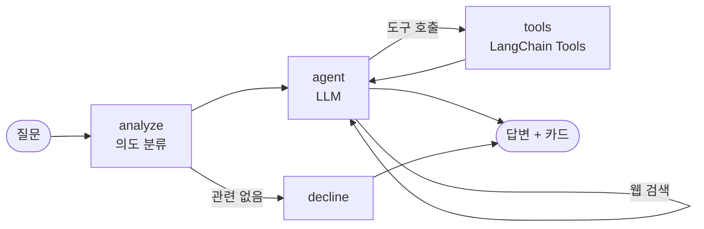

[](https://classroom.github.com/a/E--3axVr)
[](https://classroom.github.com/online_ide?assignment_repo_id=7073047&assignment_repo_type=AssignmentRepo)
[Open in Visual Studio Code](https://classroom.github.com/online_ide?assignment_repo_id=7073047&assignment_repo_type=AssignmentRepo)

# 애풀 중고물품 조회 및 가격 비교 서비스

## 1. 프로젝트 소개

이 프로젝트는 중고거래 플랫폼의 파편화로 인해 발생하는 문제점을 해결하여 보다 편리한 사용자 경험을 제공하는 데 목적이 있다. 플랫폼 파편화로 인해 이용자들은 여러 부정적 경험을 겪고 있다. 구매자의 경우 원하는 물품을 찾기 위해 여러 플랫폼에서 제품을 검색해야 하는 번거로움이 발생한다. 반면 판매자의 경우 판매하고자 하는 물건의 가격대를 알아보기 위해 여러 플랫폼에서 가격 비교를 해야 하는 문제가 있다. 이러한 불편함을 줄이기 위해 각 중고거래 플랫폼의 물품을 크롤링하여 찾고자 하는 제품만 사용자에게 보여주고, 해당 물품의 가격 추이를 볼 수 있는 기능을 제공하는 서비스를 개발하고자 한다.

---

## 2. Abstract

The purpose of this project is to provide a more convenient user experience by solving the problems caused by fragmentation of the used trading platform. Due to the fragmentation of the platform, users are experiencing a number of negative experiences. For buyers, the hassle of having to search for products on multiple platforms to find the desired item occurs. On the other hand, in the case of sellers, there is a problem in that they have to compare prices on multiple platforms to find out the price range of the goods they want to sell. In order to reduce this inconvenience, we intend to develop a service that crawls items on each used trading platform, shows only the products they want to find, and provides a function to view the price trend of the items.

---

## 3. 포스터


---

## 4. 시연 영상

[보러가기](https://www.youtube.com/watch?v=_poqCcyFmUc&feature=emb_title)

---

## 5. 팀 소개

**이준석(팀장)**

```
👨🏻‍💻****1680
📧lgh009833@kookmin.ac.kr
🔨Frontend
```

**이정우**

```
👨🏻‍💻****1676
📧lmwljw98@kookmin.ac.kr
🔨Backend
```

**임준혁**

```
👨🏻‍💻****1689
📧onejajae@kookmin.ac.kr
🔨Crawling
```

---

## 6. 사용법 (2026 업데이트)

> 2022년 버전에서 스택을 최신화했습니다. Python 3.12 / Flask 3 / Elasticsearch 8.17 / MariaDB 11.4 / Vite + React 18

### 시연용 실행 (가장 간단, Docker 불필요)

`demo.bat` 더블클릭 (또는 터미널에서 `demo.bat`). 처음 한 번은 패키지 설치로 몇 분 걸립니다.

- 백엔드 http://localhost:50000 , 프론트 http://localhost:3000 이 각각 새 창으로 뜹니다.
- Elasticsearch / MariaDB 가 없으면 자동으로 **데모 모드**(파일 기반 검색 + SQLite)로 동작하고, 샘플 매물이 자동 생성됩니다.
- 실제 번개장터 매물 추가: `backend\.venv\Scripts\python backend\crawler\main.py --sources bunjang --no-notify`
- 데모 데이터 초기화: `backend/demo_data/` 폴더 삭제 후 다시 실행

수동으로 띄우려면:

```bash
cd backend && pip install -r requirements.txt && python run.py
cd frontend && npm install && npm run dev
```

### Docker로 전체 실행

```bash
cp .env.example .env          # 선택: 포트, 비밀번호, 크롤링 설정, 알림용 SMTP
docker compose up --build -d

# 샘플 데이터 넣기 (실제 크롤링 없이 모든 화면 확인용)
docker compose exec api python crawler/main.py --sources sample --no-notify
```

| 주소 | 내용 |
|---|---|
| http://localhost:2000 | 웹 |
| http://localhost:2000/docs/ | API 문서 (Swagger) |
| http://localhost:5601 | Kibana (`docker compose --profile kibana up -d` 로 따로 실행) |

- `crawler` 서비스가 `CRAWL_INTERVAL`(기본 30분)마다 번개장터를 수집합니다. 로그: `docker compose logs -f crawler`
- 배포: `docker compose -f docker-compose.yaml -f docker-compose-prod.yaml up --build -d` (80 포트)

### 로컬 개발 (실제 Elasticsearch 사용)

```bash
# DB/ES 만 도커로 (ES 가 떠 있으면 백엔드가 자동으로 ES 를 사용)
docker compose up -d db elasticsearch

# Backend (backend/ 에서, Python 3.12+)
pip install -r requirements.txt
python run.py                                # http://localhost:50000
python crawler/main.py --sources sample      # 샘플 데이터

# Frontend (frontend/ 에서, Node 20+)
npm install
npm run dev                                  # http://localhost:3000
```

로컬에서 DB 에 붙으려면 `docker-compose.yaml` 의 `db` 에 `ports: ["127.0.0.1:3306:3306"]` 을 추가하세요.

### 필요한 키

| 항목 | 필수 | 용도 |
|---|---|---|
| `OPENAI_API_KEY` | AI 사용 시 | AI 어시스턴트 (LLM + 웹 검색). 이 키만 있으면 AI 기능 전체 동작 |
| `ADMIN_TOKEN` | 알림 사용 시 | 크롤러가 알림 목록 API 를 호출할 때 쓰는 내부 토큰 (임의의 긴 문자열) |
| `SMTP_HOST/USER/PASSWORD/FROM` | 알림 사용 시 | 지정가 알림 메일 발송 (네이버: smtp.naver.com, 앱 비밀번호) |

AI 기능 외에는 외부 API 키가 필요 없습니다. (2022년 버전의 Kakao 키는 당근 수집에만 쓰였고, 당근은 현재 비활성)

### 데이터 수집 현황

| 마켓 | 상태 |
|---|---|
| 번개장터 | 동작 (2026년 웹 API 로 재작성) |
| 당근 | 비활성 – 자동 요청 차단(403) |
| 중고나라 | 제거 – selenium 기반 미사용 코드 |

자세한 내용은 [backend/crawler/README.md](backend/crawler/README.md) 참고.

---

## 6-1. AI 어시스턴트 (2026 추가)

`.env` 에 **`OPENAI_API_KEY` 하나만** 넣으면 동작합니다. (LLM 과 인터넷 검색 모두 이 키로 처리, 기본 모델 `gpt-5.4-mini`)
화면: 상단 메뉴 **AI 어시스턴트** 또는 우측 하단 **AI에게 물어보기** 버튼.

### 구조 (LangGraph)



| 구성 | 파일 | 내용 |
|---|---|---|
| 그래프 | `backend/ai/graph.py` | LangGraph `StateGraph` (analyze → agent ⇄ tools), LLM 은 LangChain `ChatOpenAI` 로 호출 (`bind_tools`, `with_structured_output`) |
| 자체 도구 | `backend/ai/tools.py` | LangChain `@tool` 6개: 상품 찾기, 매물 검색, 시세 분석, 거래 평가(분류 + 사기 신호 탐지), 가이드 검색, 알림 등록 |
| RAG | `backend/ai/rag.py`, `backend/ai/knowledge/*.md` | 중고거래 가이드 문서를 LangChain `BaseRetriever`(한국어 BM25)로 검색 |
| 인터넷 검색 | `graph.py` | OpenAI 웹 검색 내장 도구 (출시 가격, 뉴스 등 최신 정보) |
| API | `POST /api/ai/chat` | SSE 로 진행 상황(의도, 도구 실행, 웹 출처)과 답변을 실시간 전송 |
| 화면 | `frontend/src/pages/Assistant` | 채팅, 도구 실행 과정 표시, 매물 카드·시세 차트·평가 배지, 음성 입력/읽기 |

### 평가표 대응

| 평가 항목 | 구현 |
|---|---|
| LangChain 및 LangGraph | LangGraph 상태 그래프로 에이전트 흐름 구성, LLM 호출·도구·검색기 모두 LangChain |
| RAG 와 인터넷 검색 | 가이드 문서 RAG(`search_buying_guide`) + OpenAI 웹 검색 |
| 자체 함수(Tools) 2개 이상 | 6개 (`find_product`, `search_listings`, `get_market_price`, `evaluate_deal`, `search_buying_guide`, `register_price_alert`) |
| 기술 통합·자동화 | 의도 분류 → 검색 → 시세 분석 → 거래 평가(분류) → 요약 답변이 한 번의 질문으로 연결, 음성 입력/읽기 |
| UI·UX | 웹 GUI, 아이콘, 도구 실행 과정과 결과 카드 시각화 |
| 사용자 중심성 | 질문 의도·제품·예산에 따라 다른 도구 조합과 답변 |
| 확장성 | 수집 소스·도구 플러그인 구조, Docker Compose 배포, Docker 없이 `demo.bat` 실행 |

### 시연 예시 질문
- 아이폰 15 프로 90만원 이하 매물 찾아줘
- 에어팟 프로 2를 13만원에 판다는데 괜찮아? 설명에 '카톡으로 연락, 선입금 시 예약'이라고 써 있어
- 중고 아이폰 살 때 꼭 확인해야 할 것 알려줘
- 아이폰 17 출시 가격 찾아보고 지금 중고 시세랑 비교해줘
- 맥북 에어 시세 어때? 떨어지면 알려줘, 이메일은 me@example.com 이고 80만원 이하면 돼

---

## 7. 문서

- 중간보고서

  - [바로가기](https://github.com/kookmin-sw/capstone-2022-14/blob/master/docs/팀14-중간보고서.pdf)

- 중간발표자료

  - [바로가기](https://github.com/kookmin-sw/capstone-2022-14/blob/master/docs/팀14-중간발표자료.pdf)

- 최종발표자료

  - [바로가기](https://github.com/kookmin-sw/capstone-2022-14/blob/master/docs/팀14-최종발표자료.pdf)
